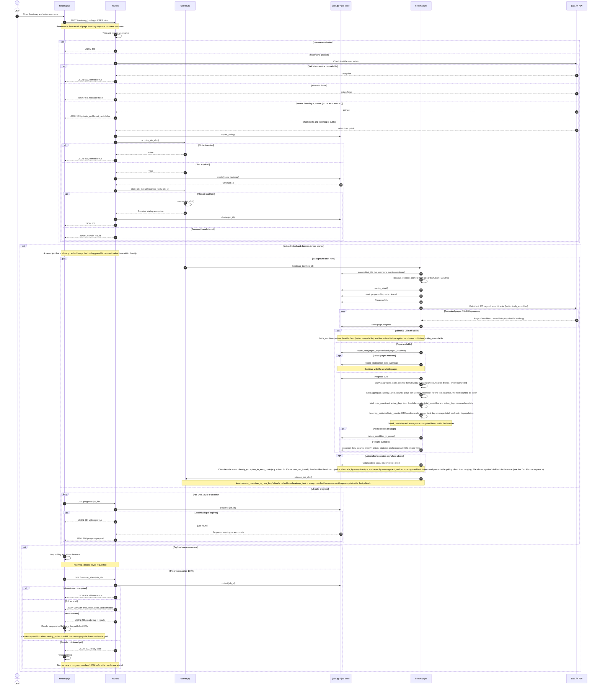

# Heatmap request and rendering sequence

Last updated: 2026-10-28

This diagram is the canonical owner of the heatmap pipeline sequence. Partial
Last.fm data is a successful result with a warning, while terminal fetch
failure produces an error.

The pipeline stores `partial_data_warning` in job stats and continues through
aggregation. `/heatmap_data` therefore returns `ready: true` when partial data
still yields results.

The client requests `/heatmap_data` only after progress reaches 100%, so the
202 response covers a narrow race and not ordinary processing. Both
`/progress` and `/heatmap_data` also return HTTP 400 for a missing `job_id`;
the client always sends one, so those responses are not drawn.

`heatmap.py` self-arrows cover in-process work and the `cleanup_expired_cache()`
helper it imports from `utils.py`, which is not drawn as a participant.
A total Last.fm failure is an exception, not a status: `lastfm.fetch_scrobbles`
raises a typed provider failure, and the one backstop -- the
`opt Unhandled exception anywhere above` block -- classifies it by type with
`errors.classify_exception_to_error_code`, the classifier the album pipeline
also uses, and publishes that code (`lastfm_unavailable` for an outage). A
fault the classifier does not recognize is ours, so it publishes
`internal_error` instead (F-SWE-5).
